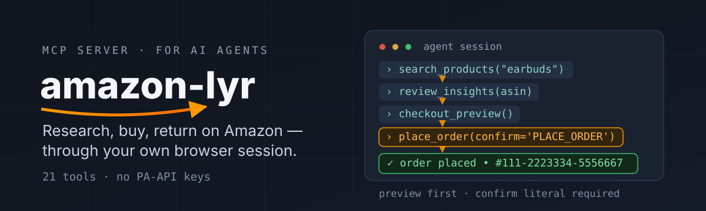

<p align="center">
  
  
  
  
</p>

<h1 align="center">amazon-lyr</h1>

<p align="center">
  <strong>The full Amazon lifecycle as MCP tools for AI agents</strong> — research
  products and reviews, manage the cart, place orders, track shipments, start
  returns — all through your own logged-in browser session. No PA-API keys.
</p>

<p align="center">
  
</p>

---

## An agent session, start to finish

This is one real conversation with an agent running `amazon-lyr` — no steps hidden:

```text
1. search_products("noise cancelling headphones", max_price=300, min_rating=4)
2. review_insights("B0X1234567")            # star spread + keyword themes
3. search_in_reviews("B0X1234567", query="broke")     # what actually breaks?
4. add_to_cart("B0X1234567", quantity=1)
5. checkout_preview()                        # totals + address + payment, nothing bought
6. place_order(confirm="PLACE_ORDER")       # only after the user said "buy it"
   ✓ order placed · #111-2223334-5556667
7. track_shipment("111-2223334-5556667")
8. initiate_return("111-2223334-5556667", reason="defective", asin_hint="…")
9. list_returns()                           # refund status confirmed
```

Every step is a typed MCP tool call. The buying step is deliberately hard to
fire by accident — see [Safety model](#safety-model).

## Why it's different

| | |
|---|---|
| **No API keys** | Speaks Amazon's own web endpoints over `curl_cffi` with Chrome TLS impersonation — the same session your browser has |
| **Full lifecycle** | Not just scraping: cart mutations, wishlist writes, checkout with confirmation parsing, returns wizard, cancellations |
| **Agent-native errors** | CAPTCHAs, sign-out redirects and soft throttles surface as typed errors with recovery hints (`possibly_throttled`, manual-fallback URLs) — never silent garbage |

## How it works

```
browser cookies ──▶ AmazonClient (curl_cffi, captcha-aware)
                        │
                        ▼
              bs4 parsers ──▶ normalized dicts ──▶ 21 FastMCP tools
                                                   (readOnly / destructive annotations)
```

Auth is your own session: `amazon-lyr login` imports cookies from Chrome,
Brave, Firefox, Edge or Zen via [obscura-core](https://github.com/ishan-parihar/obscura-core),
or from an explicit JSON export. Reads need the login token; cart, orders,
returns and checkout also need the session context cookies.

## Install

```bash
# Persistent install — uv tool (isolated; bootstraps uv on clean systems)
curl -fsSL https://raw.githubusercontent.com/ishan-parihar/amazon-lyr/main/install.sh | bash

# Zero-install run without persistence:
uvx --from git+https://github.com/ishan-parihar/amazon-lyr amazon-lyr --version
```

Then authenticate once and serve:

```bash
amazon-lyr login --browser chrome            # or: --cookies-file cookies.json
amazon-lyr search "mechanical keyboard"      # shell works immediately
amazon-lyr serve                             # MCP server (stdio)
```

```json
{
  "mcpServers": {
    "amazon": {
      "command": "amazon-lyr",
      "args": ["serve"]
    }
  }
}
```

## Tools (21)

| Category | Tools |
|----------|-------|
| **Search** | `search_products` (department, price range, min-rating filters) |
| **Product** | `get_product`, `compare_products` (up to 5 ASINs) |
| **Reviews** | `get_reviews`, `review_insights`, `search_in_reviews` |
| **Cart** | `add_to_cart`, `view_cart`, `update_cart_quantity`, `remove_from_cart` |
| **Wishlist** | `add_to_wishlist`, `get_wishlist` |
| **Orders** | `get_orders`, `get_order_details`, `track_shipment` |
| **Returns** | `list_returns`, `initiate_return` (friendly reason codes) |
| **Buying** | `checkout_preview`, `place_order` |
| **Danger zone** | `cancel_order` |
| **Session** | `get_session_status` |

## Safety model

Money moves through exactly two gates:

1. **Session gate** — every mutation requires full login cookies
   (`at-main` + `session-id`/`ubid-main`). Reads-only sessions are refused
   before any request is made.
2. **Consent gate** — `place_order` refuses to run unless passed the exact
   literal `confirm="PLACE_ORDER"`. The intended flow is:
   preview for the user → user approves → then pass the literal.
   `cancel_order` and `initiate_return` are similarly annotated as
   destructive/non-idempotent so agent frameworks treat them accordingly.

Card verification (OTP / 3-D Secure) is detected mid-checkout and reported
as `needs_verification` with browser instructions — never guessed through.

## Limits

Honest ceilings, all surfaced as typed errors instead of wrong data:

- **CAPTCHA walls** — account-area pages are stricter than the catalog;
  re-import fresh cookies or wait it out (`CaptchaError` includes hints)
- **Soft throttles** — sub-3-second cadences get silent empty grids;
  responses carry `possibly_throttled: true` when suspected
- **Geo price variants** — some variants render prices client-side;
  search falls back to text-scanning, `get_product` stays authoritative
- **No auto-buy without consent** — by design; checkout demands the explicit
  confirm literal and user approval

## Development

```bash
git clone https://github.com/ishan-parihar/amazon-lyr && cd amazon-lyr
uv sync --extra dev
uv run ruff check . && uv run pytest -q
```

Architecture notes, invariants, and the release process live in
[AGENTS.md](AGENTS.md).

## License

MIT © [Ishan Parihar](https://github.com/ishan-parihar)
